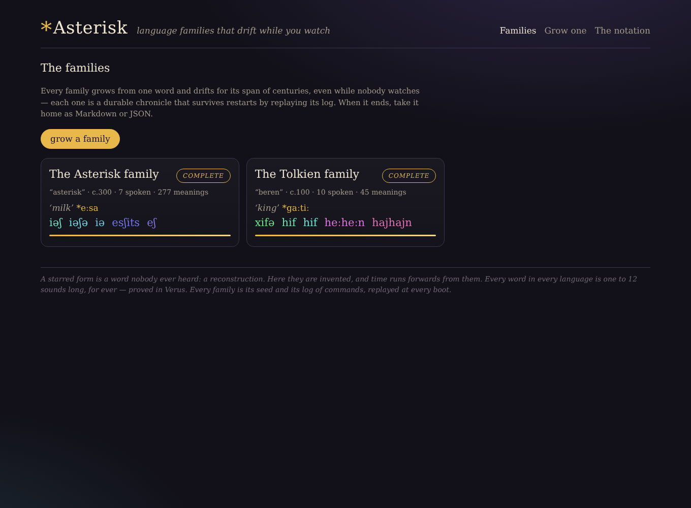
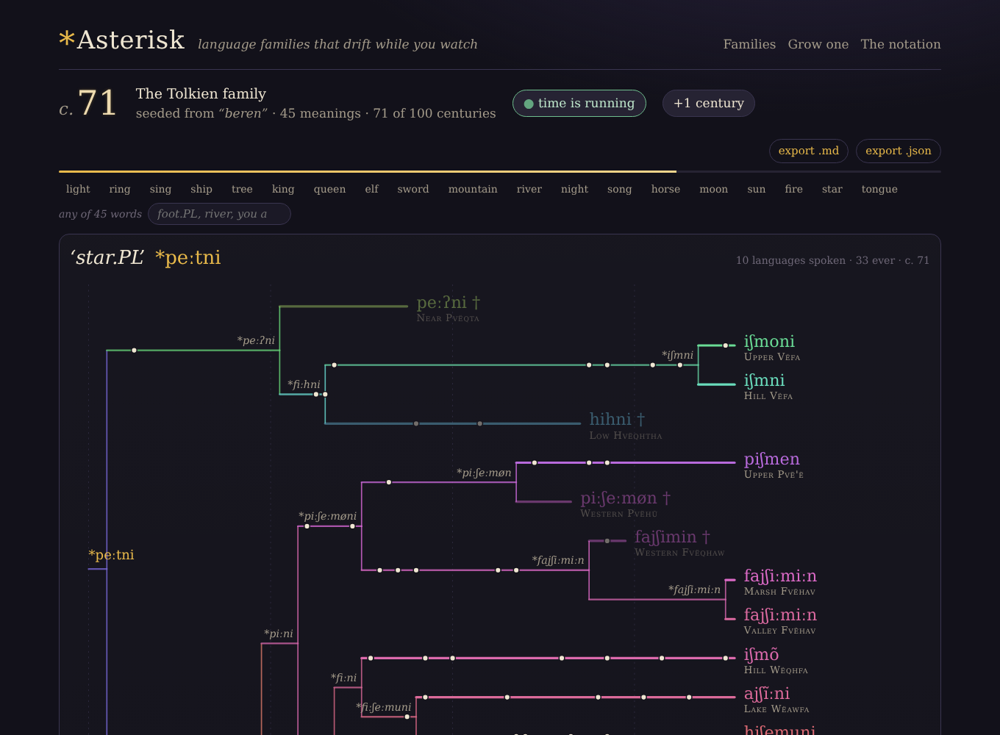
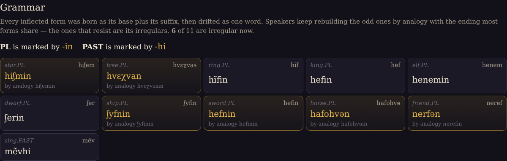
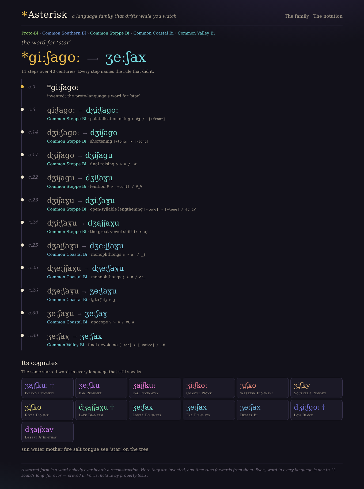
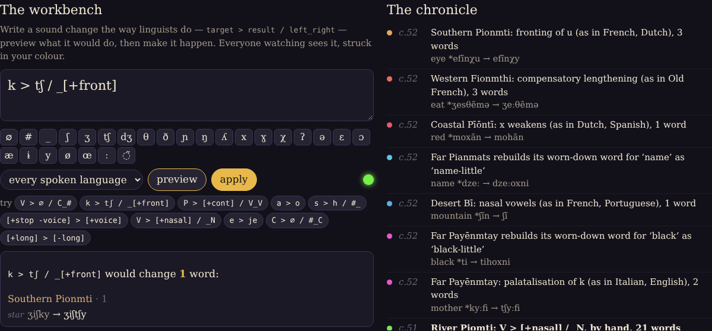
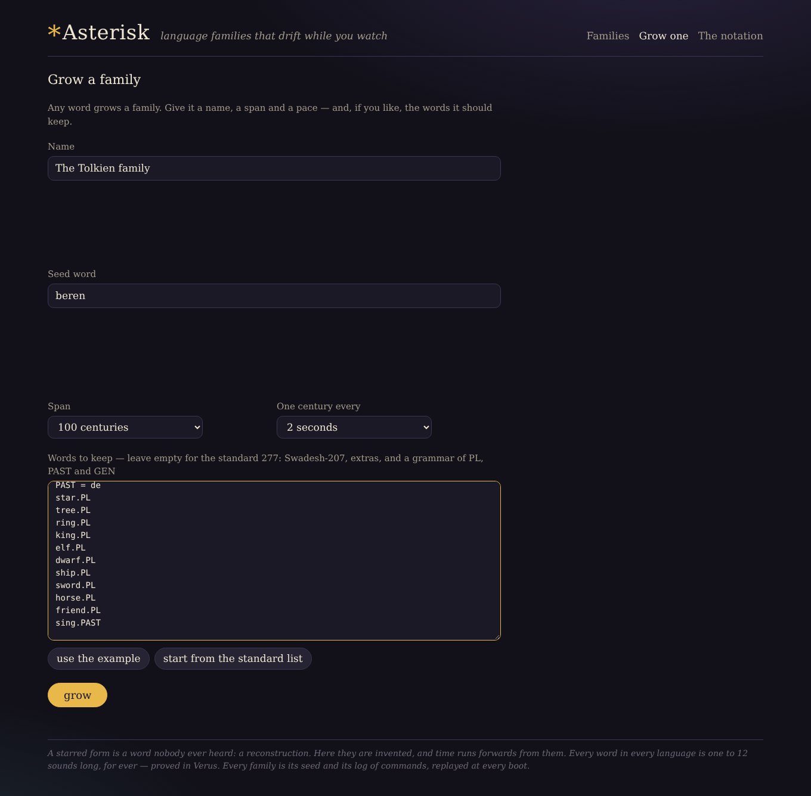

# *Asterisk

**A language family that drifts while you watch.**

> **`./verify.sh` is the authoritative gate.** It runs on the pinned toolchain
> (rustc 1.97.1) and runs Verus over `verus/`. The gates run in the cloud
> during the build — fmt, clippy, tests, boot — are a weaker pre-check on a
> different machine with **no Verus**; they say nothing about the proofs.

```sh
cargo run --release -p asterisk-app      # then open http://localhost:3000 — twice
./verify.sh                              # the real gate (Verus included)
```

No Docker, no API keys. State lives in `./asterisk-data/` (two SQLite files);
delete it to start over.



## What it is

Asterisk invents a proto-language from a word — a small sound system and a
whole vocabulary — and then lets time happen to it. Every century each living
language may undergo a **sound change**, written in the notation historical
linguists use (`k > tʃ / _[+front]`), drawn from a library of 51 changes that
really happened somewhere (Grimm's law, the Great Vowel Shift, French nasal
vowels, Spanish breaking, Latin rhotacism…). Languages split, drift apart,
borrow from each other, fall silent. Words worn down to one sound get rebuilt
as compounds, the way Latin *sol* became French *soleil*.

* **A gallery of families.** Each grows from its own seed word, runs for its
  own span of centuries at its own pace — two seconds or an hour a century —
  and keeps running while nobody watches.
* **A real vocabulary.** The standard list is Swadesh-207 plus 34 extras —
  or bring your own: `moon = mena`, `star`, `PL = s`, `star.PL`.
* **Grammar that breaks.** Suffixes (`PL`, `PAST`, `GEN`) and inflected forms
  (`foot.PL`) are born fused and drift as one word, so sound change makes
  irregular plurals nobody wrote a rule for — and analogy keeps rebuilding
  them from the ending most forms share, the way *kine* became *cows*. Some
  families lose their plural ending altogether and keep a few stranded old
  ones, like English *oxen*.
* **The tree** draws one word across a family; beads mark where it changed.
  **The etymology** of any word is its whole life, each step naming its rule.
* **The workbench** previews your own sound change, then sends it to the
  family's chronicle; every browser sees it land, in your colour.
* **Export** a family as a Markdown grammar book — a Mermaid family tree, a
  cognate table, and for every language its sound changes in order, its
  sounds, its productive endings and irregulars, and its whole lexicon with
  every word's history — or as JSON. One language at a time, too.
* **Durable.** Every century and every typed rule is a turn of a Harvest
  workflow and a row in a command log. Kill the server mid-century; it
  rebuilds every family by replaying its log and the chronicles carry on.







## How it works

* `crates/asterisk` — the engine. No IO, no async, no clock.
  * `lexicon` — vocabularies (standard or your own), words, paradigms, and
    inventing a proto-language.
  * `export` — a family as a Markdown grammar book, or as JSON.
  * `phon` — an 85-segment inventory with features, and 15 total feature edits.
  * `rule` — the sound-change language: parser, canonical printer,
    **simultaneous** application, and the **guard** (a change that would leave
    a word empty or longer than 12 segments leaves it alone).
  * `library` — the 51 attested changes, written in that language.
  * `world` — the tree of languages; a history per language; productive
    endings, irregulars and levelling; `etymology`; and the command log —
    `run`, `digest`, `replay_commands`.
* `crates/asterisk-app` — autumn-web 0.9: Maud pages, a server-rendered SVG
  tree, one live-events topic over SSE, CSRF on every POST, one script.
  * `store` — the command log in SQLite: the only durable state.
  * `chronicle` — one autumn-harvest-sqlite workflow per family: the clock,
    and the single writer.
  * `atlas` — the gallery; `apply_at`, the exactly-once path every command takes.
* `verus/src/asterisk.rs` — the verified core.

See [`docs/SPEC.md`](docs/SPEC.md) for the rules and
[`docs/adr/0002`](docs/adr/0002-durable-replay-on-harvest.md) for how a family
survives a restart.

## The guarantee

Every word in every language, at every century, after any sequence of sound
changes — drifted or typed by hand — is 1 to 12 segments from the inventory.
`verus/src/asterisk.rs` proves closure, the growth bound, the guard, the
induction over any history, executable `apply_raw`/`step` equal to the spec,
that the family tree's parent links always reach the proto-language — and
that the command log is exactly-once: a redelivered offer changes nothing and
the log only ever grows by extension, one entry per offer at most.
`docs/SPEC.md` §5 ranks each obligation by how confident I am it verifies as
written — none of it has been run through Verus yet.

The same properties are property-tested, plus: rules round-trip through the
printer (`parse(print(r)) == r`), application is order-free, and **every
lexicon replays** from the proto-language and its recorded rules with
arbitrary hand rules mixed in.

## Tests

80 tests: 50 engine unit, 11 property suites (600 cases each for rules; 24
whole worlds with hand rules; 16 command logs replayed), 9 app unit (store,
gallery, exactly-once), 8 HTTP against a real `TestApp`, a Harvest test that
kills the driver mid-chronicle and resumes it from the same file, and a
doctest — plus `verify.sh`'s end-to-end gate, which `kill -9`s the real binary
mid-chronicle and requires that nothing logged is lost and every family
replays exactly.

## Configuration

All optional — see `.env.example`: `ASTERISK_DATA` (default `asterisk-data`),
`ASTERISK_CENTURY_SECS` for the first family (default 6),
`ASTERISK_CLOCK=off` to run commands as they arrive with no Harvest clock.

## Where this could go

* **Snapshots.** Replay is fast at a few hundred centuries; very long spans
  want a stored world and the `seq` it reflects, checked by the digest.
* **An engine version in the log**, so a log from an older engine can be
  replayed by the engine that wrote it.
* **Geography.** Daughters migrate across a generated coastline and borrow
  from neighbours, so the map shapes the tree.
* **The comparative method as a game.** Show only the living languages and
  let the player reconstruct the starred forms; score against the truth.
* **Sound.** A formant synthesiser, so you can hear *moon* drift.
* **Insertion and metathesis.** The rule language has no epenthesis-from-
  nothing (`∅ > ə / C_C`) or metathesis yet; both need a different
  simultaneous semantics and a matching change to the Verus model.
* **Grammar.** Affixes that grammaticalise and erode, not just roots.
